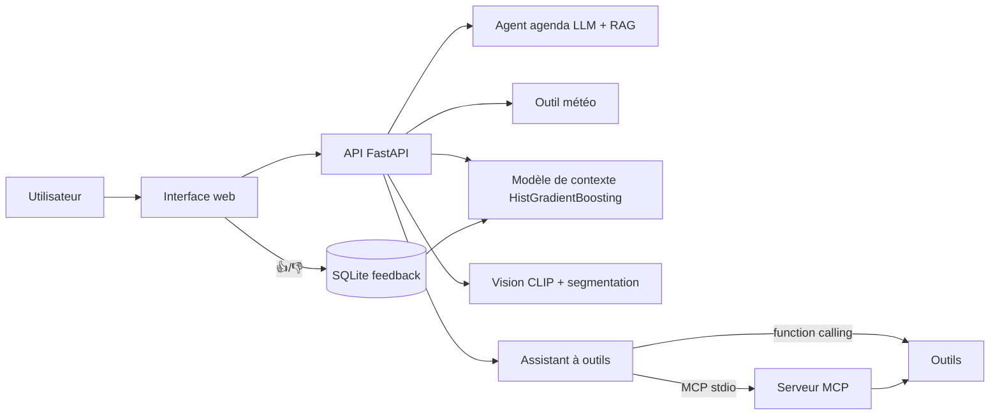

# DressMe — fiche technique (module « tenue du jour »)

## 1. Vue d'ensemble

## 2. Agents LLM : rôle et modèle de chacun
Chaque agent a **un rôle distinct** et un modèle propre (variable `LLM_MODEL_<AGENT>` du fichier `.env`). Voir le résultat en direct : `http://localhost:8000/api/agents`.
| Agent | Rôle | Modèle choisi | Pourquoi |
|---|---|---|---|
| Agenda | Comprendre le texte libre (FR / AR / EN) et en déduire occasion, formalité, genre | `openai/gpt-oss-20b` | Extraction courte : un petit modèle rapide suffit et ménage le quota. À confirmer par `python -m training.eval_models` |
| Styliste (explain) | Rédiger une phrase honnête par tenue, alertes comprises | `openai/gpt-oss-20b` | Rédaction brève ; modèle différent du juge |
| Assistant | Orchestrer les outils (météo, fiches, recommandation) et répondre | `openai/gpt-oss-120b` | Plus grand : l'appel d'outils exige un suivi d'instructions fiable (vérifié par `check_llm`) |
| Juge principal | Noter explications et fidélité (hors ligne) | `qwen/qwen3.8-27b` | **Famille différente** (Alibaba) des modèles qui génèrent (OpenAI) : évite l'auto-préférence |
| Juge 2 | Second avis pour mesurer l'accord entre juges | `openai/gpt-oss-120b` | Plus grand que le générateur ; même famille : limite à citer |
Les modèles utilisables sont ceux listés par `https://api.groq.com/openai/v1/models` pour la clé. Vérification de la configuration : `python -m training.check_llm`.
Autres modèles non LLM : CLIP ViT-B/32 (vision), SegFormer et U²-Net (découpe), HistGradientBoosting (classement des tenues).

## 3. Techniques de prompting utilisées
| Technique | Où | Effet |
|---|---|---|
| Prompt système + rôle | tous les agents | Cadre la tâche |
| Few-shot (6 exemples FR/AR) | agent agenda | Stabilise le format et le dress code |
| Sortie JSON contrainte + validation (`assert`) | agent agenda, styliste | Réponse exploitable ; rejet des sorties invalides |
| Température 0 | tous | Reproductibilité |
| Contexte récupéré (RAG) injecté dans le prompt, avec consigne d'ignorer le hors-sujet | agent agenda | Ancrage dans les usages locaux |
| Consigne d'honnêteté (alertes de la tenue) | styliste | Évite de justifier un mauvais choix |
| Function calling (JSON-schema) | assistant | Le LLM choisit et paramètre les outils |
| Robustesse : retry sur 429, cache, repli par mots-clés | agenda | Disponibilité malgré le quota gratuit |

## 4. RAG
Corpus : 15 fiches (mariage, aïd, jomaa, ramadan, soutenance, chaleur, pluie, condoléances…) rédigées à la main (`app/rag.py`) — **à faire relire**.
Index TF-IDF sur n-grammes de caractères (3-5) : robuste au français et à l'arabe. Récupération top-3 avec seuil de similarité, injectée dans le prompt.
Évaluation : `python -m training.eval_rag` → hit@1 = 0,93 et hit@3 = 1,0 sur 15 requêtes (jeu et corpus écrits par la même personne : résultat optimiste).
Limites : faux positifs possibles (« journée tranquille » → fiche Université), corpus petit, pas d'embeddings sémantiques. Piste : embeddings multilingues + re-ranking.

## 4 bis. Améliorations mesurées ou testées (v3.2)
| Changement | Pourquoi | Vérification |
|---|---|---|
| Couleur : variables de pixels du vêtement ajoutées à CLIP ; palette fusionnée (navy blue→navy, charcoal→grey…) | La couleur était le point faible (F1 0,51) | La meilleure version est choisie automatiquement sur la validation (`variant` dans `models/vision_metrics.json`) |
| `usage` : Party et Smart Casual fusionnés (15 et 41 exemples) ; Smart Casual/Formal redéduits du type | Classes trop rares pour être apprises | Règle testée (pytest) |
| Saison prédite utilisée seulement si confiance ≥ 0,7 | Précision 0,62 | Testé |
| Nettoyage : doublons sur nom + couleur + type ; seuil de classe 40 | La dédup par nom retirait un tiers des données ; jupes, blazers… étaient exclus | À mesurer : `data/data_report.json` |
| Classement : option `--objective regress` testée | Hypothèse : mieux ordonner les tenues | **Pas d'amélioration** (regret 0,025 contre 0,028) : défaut conservé. Violations top-1 : 21,7 % contre 19,8 % pour le meilleur choix possible : l'écart est surtout dû aux garde-robes limitées |
| Endpoint `/api/agents` | Voir quel agent utilise quel LLM | Testé |
| Test d'interface jsdom (`tests/ui_smoke.js`) | L'interface n'était testée que par syntaxe | 11 vérifications passent (pas un vrai navigateur : ni mise en page ni envoi de photo) |

## 5. Fine-tuning
| Modèle | Statut |
|---|---|
| Vision CLIP | Sonde linéaire (poids gelés) faite. `--finetune` dégèle les derniers blocs, compare au F1 macro de la sonde et garde la meilleure version |
| Modèle de contexte | Entraîné de zéro sur données synthétiques (étiquettes par règles + bruit), puis réajusté avec les 👍/👎 réels (`--feedback`) |
| LLM | **Non fine-tuné** : prompt + RAG suffisent, quota gratuit, aucune donnée d'agenda étiquetée. Piste : LoRA sur un petit modèle avec des exemples générés puis validés |

## 6. Évaluation
| Composant | Mesure | Résultat |
|---|---|---|
| Vision `articleType` | accuracy / F1 macro (test) | 0,88 / 0,85 |
| Vision couleur | idem | 0,62 / 0,51 (faible) |
| Vision `usage` | accuracy (référence « toujours Casual » : 0,74) | 0,82 ; F1 macro 0,54 (classes rares) |
| Vision saison | idem | 0,62 (colonne peu fiable) |
| Modèle de contexte | AUC ; violations de contraintes top-1 vs hasard | 0,87 ; 27 % vs 61 % — **étiquettes synthétiques : mesure circulaire** |
| Agent agenda | `python -m training.eval_agent` : règles vs LLM vs LLM+RAG, avec intervalles de confiance | Voir `docs/EVALUATION.md` |
| Explications | `python -m training.eval_judge` : LLM-as-a-judge + contrôle négatif | Voir `docs/EVALUATION.md` |
| Assistant à outils | `python -m training.eval_tools` : outils, ordre, arguments, fidélité | Voir `docs/EVALUATION.md` |
| RAG | hit@1 / hit@3 | 0,93 / 1,0 |
| Logiciel | `pytest` | 13 tests (API, exclusions, feedback, vision pipeline, RAG, outils, MCP) |
| Métrique métier | taux de tenues acceptées (👍) | `/api/stats` |

## 7. Comment le LLM communique avec les outils
| | Function calling (local) | MCP |
|---|---|---|
| Principe | Le backend envoie les schémas JSON ; le LLM répond par des `tool_calls` ; le backend exécute et renvoie un message `tool` | Un **serveur MCP** expose les outils ; un **client MCP** les découvre (`list_tools`) et les appelle (`call_tool`) par un protocole standard (stdio) |
| Code | `app/tools.py`, `app/assistant.py` | `app/mcp_server.py` + client dans `app/assistant.py` |
| Avantage | Simple, rapide | Outils réutilisables par tout client MCP (ex. Claude Desktop) |
| Limite ici | — | Le serveur MCP est un autre processus : il utilise la garde-robe de démo, pas celle du navigateur |
Outils : `get_weather`, `search_dress_code`, `recommend_outfits` — tous en lecture seule. Chaque appel est tracé et affiché dans l'interface.
Claude Desktop : `{"mcpServers":{"dressme":{"command":"python","args":["-m","app.mcp_server"],"cwd":"D:\\dressme"}}}`

## 8. Limites connues
Étiquettes d'entraînement du modèle de contexte synthétiques ; couleur détectée peu fiable ; photos de catalogue différentes des photos de téléphone ; LLM gratuit limité en débit ; interface testée par analyse de syntaxe, pas dans un navigateur automatisé.
